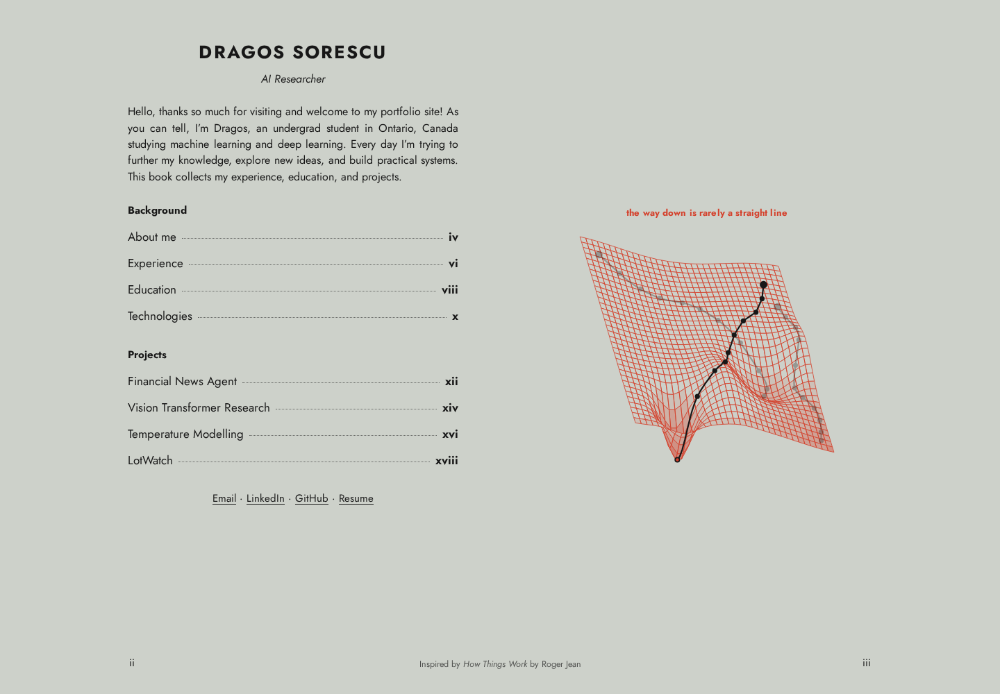

# Dragos Sorescu — Portfolio

A book-style portfolio of my background, experience, education, and machine learning projects. Built with plain HTML, CSS, and JavaScript, with original SVG diagrams, responsive layouts, and automatic light and dark themes.

[Visit the portfolio](https://sxres.dev/)



## Run locally

No dependencies or build step are required. From the repository root, run:

```sh
python3 -m http.server 4173 --bind 127.0.0.1
```

Then open <http://127.0.0.1:4173>.

## Navigation

Select a chapter from the contents to open it. Use the left and right arrow keys to move between chapters, or press Escape to return to the contents. Each chapter also has a **Back to contents** button.

## Editing

- `index.html` contains the page shell, metadata, and social previews.
- `script.js` contains the introduction, chapter content, SVG illustrations, and navigation.
- `style.css` controls the book layout, typography, themes, and mobile presentation.
- `Dragos_Sorescu_Resume.pdf` is the downloadable resume.
- `docs/screenshot.png` is the home page screenshot shown above.

The site can be served directly from the repository root by any static host. `CNAME`, `robots.txt`, and `sitemap.xml` contain the domain configuration for `sxres.dev`.

The book design is inspired by *How Things Work* by Roger Jean.
